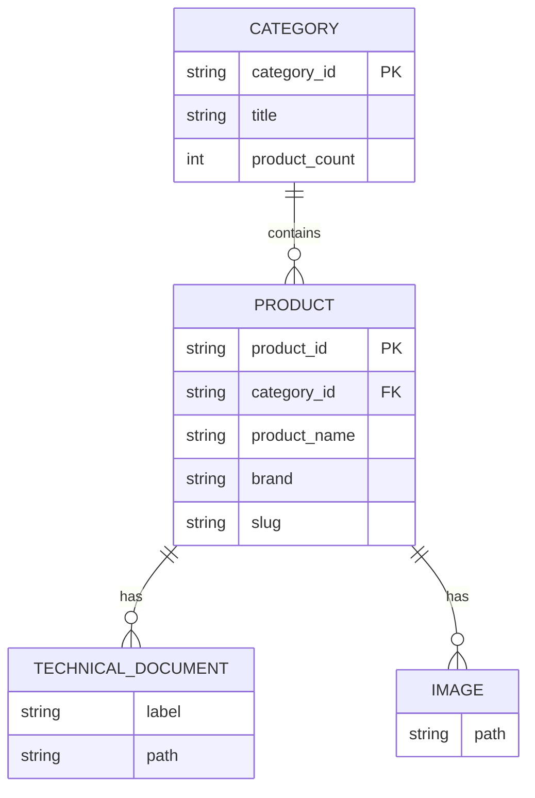

# Data Dictionary — Isolsolutions Product Catalog

**Version:** 1.0.0  
**Last Updated:** 2026-11-22  
**Format:** JSON (`data/processed/products_clean.json`)

---

## Top-Level Structure

The cleaned dataset is a JSON object with three top-level keys:

```json
{
  "metadata": { ... },
  "categories": { ... },
  "products": [ ... ]
}
```

---

## `metadata` Object

| Field | Type | Required | Description | Example |
|-------|------|----------|-------------|---------|
| `version` | string | ✅ | Semantic version of the data schema | `"1.0.0"` |
| `last_updated` | ISO 8601 datetime | ✅ | Timestamp of last pipeline run | `"2026-11-22T17:39:01Z"` |
| `total_products` | integer | ✅ | Number of products in the dataset | `34` |
| `total_categories` | integer | ✅ | Number of product categories | `6` |
| `brand` | string | ✅ | Primary brand name | `"Isolsolutions"` |
| `source` | string | ✅ | Original source file name | `"products-data.js"` |
| `pipeline_version` | string | ✅ | Version of the cleaning pipeline | `"1.0.0"` |

---

## `categories` Object

A dictionary keyed by `category_id` (kebab-case slug). Each value:

| Field | Type | Required | Validation | Description | Example |
|-------|------|----------|------------|-------------|---------|
| `category_id` | string | ✅ | `^[a-z0-9-]+$` | Unique kebab-case identifier | `"laine-de-roche"` |
| `title` | string | ✅ | Non-empty | Human-readable category name (French) | `"Laine de Roche"` |
| `description` | string | ✅ | — | Category description for display | `"Isolation thermique et acoustique..."` |
| `image` | string | ✅ | Valid relative path | Category hero image path | `"assets/images/solution-images/laine-roche.png"` |
| `badge` | string | ✅ | — | Marketing badge label | `"Certifié"` |
| `meta_description` | string | ❌ | — | SEO meta description | `"Laine de roche Isolsolutions..."` |
| `product_count` | integer | ❌ | ≥ 0 | Number of products in this category | `9` |

### Valid Category IDs
| ID | Title |
|----|-------|
| `panneaux-acoustiques` | Panneaux Acoustiques |
| `laine-de-roche` | Laine de Roche |
| `portes-isolees` | Portes Isolées |
| `revetements-techniques` | Revêtements Techniques |
| `isolation-industrielle` | Isolation Machines Industrielles |
| `produits-sur-commande` | Produits sur Commande |

---

## `products` Array

Each element is a product object:

### Core Identification Fields

| Field | Type | Required | Validation | Description | Example |
|-------|------|----------|------------|-------------|---------|
| `product_id` | string | ✅ | `^[a-z0-9-]+$`, unique | Primary key — kebab-case identifier | `"rockwool-rockfacade"` |
| `slug` | string | ✅ | `^[a-z0-9-]+$` | URL-safe slug (derived from product_id) | `"rockwool-rockfacade"` |
| `category_id` | string | ✅ | Must match a key in `categories` | Foreign key to category | `"laine-de-roche"` |
| `category_name` | string | ❌ | — | Denormalized category display name | `"Laine de Roche"` |

### Product Information Fields

| Field | Type | Required | Validation | Description | Example |
|-------|------|----------|------------|-------------|---------|
| `product_name` | string | ✅ | Non-empty, ≤150 chars | Full product name (French) | `"Rockwool Rockfaçade"` |
| `brand` | string | ✅ | Non-empty | Manufacturer brand | `"Rockwool"` |
| `short_description` | string | ✅ | Non-empty | Brief product summary (1-2 sentences) | `"Panneau laine de roche..."` |
| `full_description` | string | ✅ | Non-empty | Detailed product description (paragraph) | `"Le Rockwool Rockfaçade est..."` |
| `badge` | string | ✅ | — | Marketing badge for UI display | `"Façade ventilée"` |

### Media Fields

| Field | Type | Required | Validation | Description | Example |
|-------|------|----------|------------|-------------|---------|
| `primary_image` | string | ✅ | Valid relative file path | Main product image | `"assets/images/products/laine-de-roche/rockwool-rockfacade/main.png"` |
| `images` | string[] | ❌ | Array of valid paths | All product images (includes primary) | `["assets/.../main.png"]` |
| `technical_documents` | object[] | ❌ | Array of `{label, path}` | PDF technical datasheets | See below |

### `technical_documents` Item Schema

| Field | Type | Required | Description | Example |
|-------|------|----------|-------------|---------|
| `label` | string | ✅ | Display label for the document | `"Fiche technique Rockwool Rockfaçade"` |
| `path` | string | ✅ | Relative file path to PDF | `"data_produits/Laine de roche/Fiche produit Rockfaçade.pdf"` |

### Technical Fields

| Field | Type | Required | Validation | Description | Example |
|-------|------|----------|------------|-------------|---------|
| `advantages` | string[] | ❌ | — | List of product advantage bullets | `["Incombustible Euroclasse A1..."]` |
| `specifications` | object | ❌ | Key-value string pairs | Technical specs dictionary | `{"Épaisseur": "40 mm", "Densité": "90 kg/m³"}` |
| `seo_keywords` | string | ❌ | — | Comma-separated SEO keywords | `"panneau acoustique mural..."` |

### Metadata Fields

| Field | Type | Required | Validation | Description | Example |
|-------|------|----------|------------|-------------|---------|
| `source_file` | string | ❌ | — | Original source file | `"products-data.js"` |
| `created_at` | ISO 8601 datetime | ❌ | — | Record creation timestamp | `"2026-11-22T17:39:01Z"` |
| `updated_at` | ISO 8601 datetime | ❌ | — | Last modification timestamp | `"2026-11-22T17:39:01Z"` |

---

## Fields NOT Present (By Design)

The following fields are absent because this is a B2B quote-request catalog:

| Field | Reason |
|-------|--------|
| `price` / `currency` | Products sold via quote request (devis), no fixed prices |
| `sku` | No SKU system in original data |
| `stock_quantity` | No inventory management |
| `availability_status` | All products available for quote |
| `product_condition` | All products are new |
| `discount_percentage` | No discount model |
| `original_price` | No pricing data |
| `product_url` | URLs are generated dynamically by the frontend JS |

> [!NOTE]
> These fields were deliberately omitted from the schema rather than populated with empty/null values. If pricing or inventory management is added in the future, the schema should be extended accordingly.

---

## Specifications Keys Reference

Common specification keys found across products (French):

| Key | Products Using | Typical Values |
|-----|---------------|----------------|
| `Épaisseur` | 15 | `"40 mm"`, `"50 mm"`, `"20 mm"` |
| `Densité` / `Masse volumique` | 14 | `"90 kg/m³"`, `"150 kg/m³"` |
| `Coefficient d'absorption αw` | 11 | `"0.85"`, `"0.95"` |
| `Classement au feu` | 18 | `"A2-s1,d0"`, `"A1 — Incombustible"` |
| `Dimensions` | 14 | `"1200 × 600 mm"` |
| `Conductivité thermique λ` | 9 | `"0,035 W/m·K"` |
| `Marque` | 9 | `"Rockwool"`, `"Volcalis"` |
| `Résistance thermique R` | 7 | `"1,10 à 6,85 m²·K/W"` |
| `Certifications` | 5 | `"ACERMI 02/015/027 · KEYMARK..."` |
| `Norme de test` | 4 | `"EN ISO 10140"` |
| `Température maximale` | 4 | `"500°C"`, `"650°C"` |

---

## Relationships


